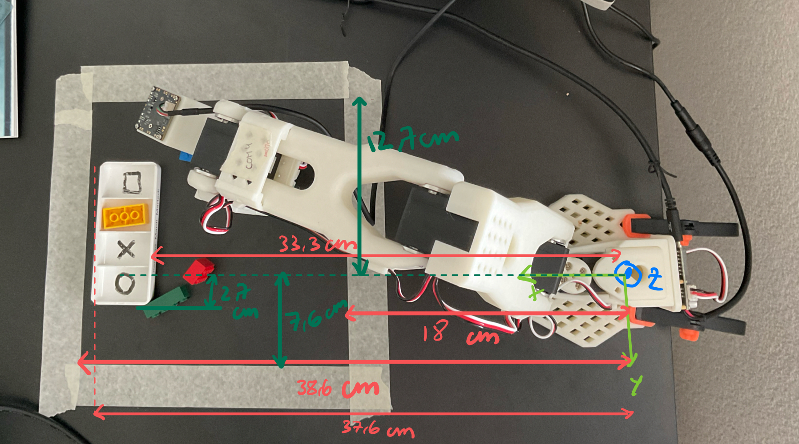
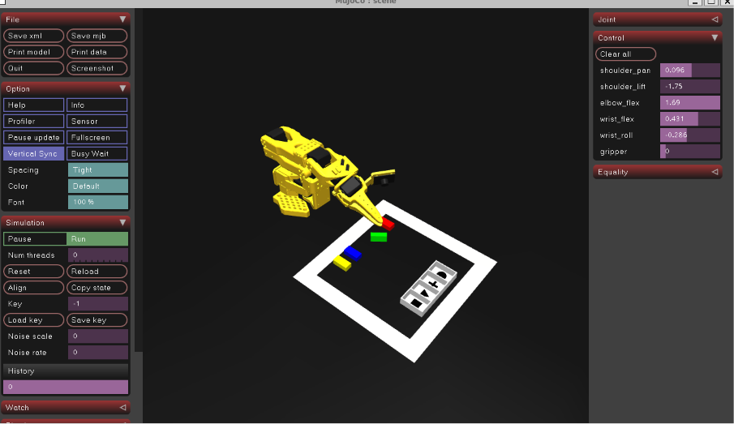
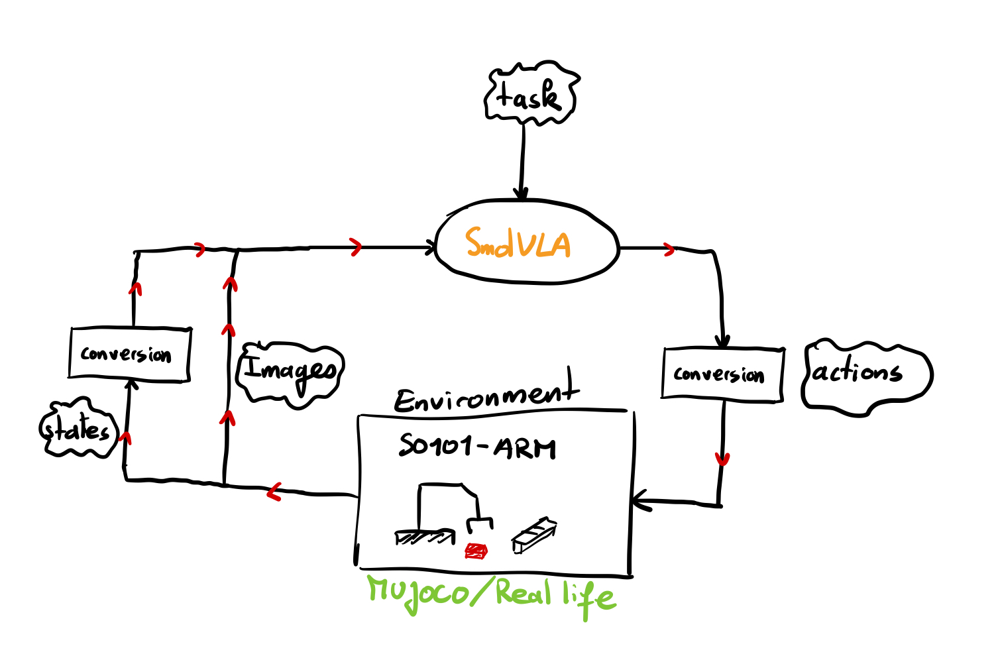
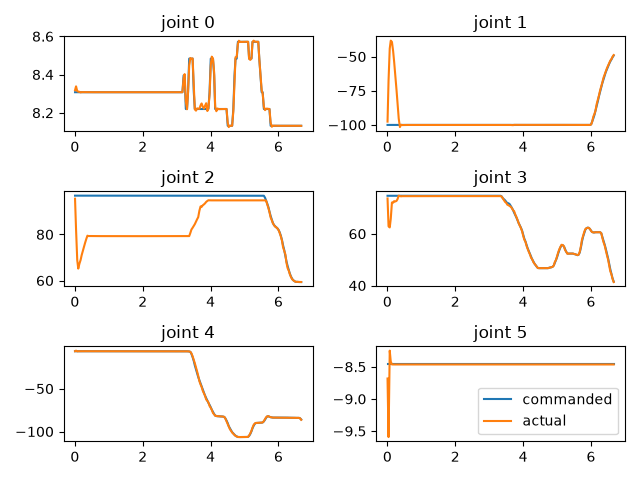
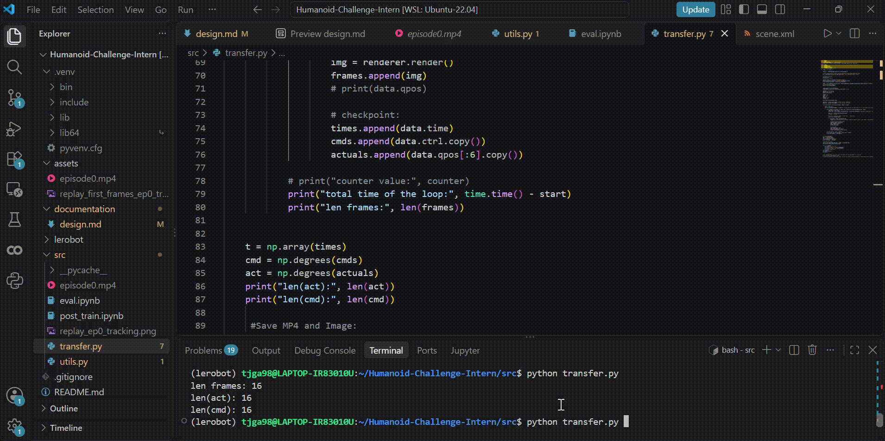
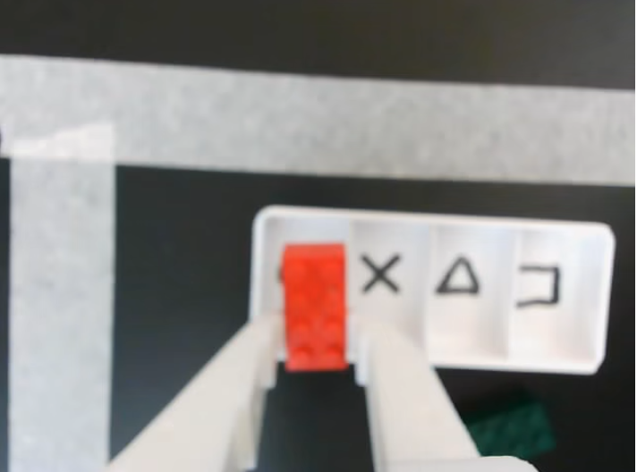
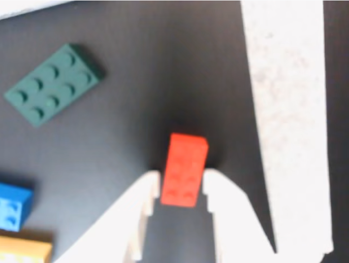
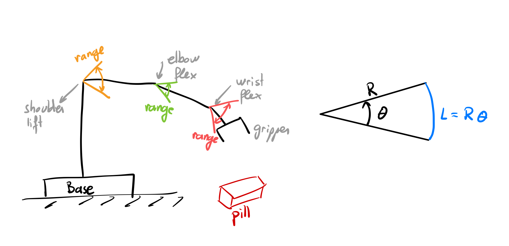
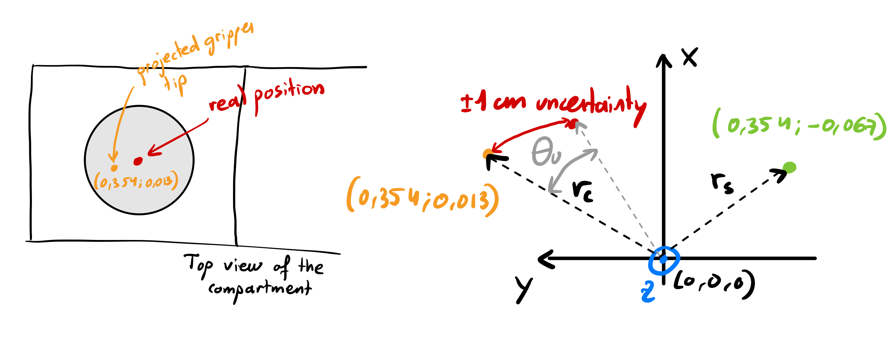

# Robotic Medication Sorting using SmolVLA

## Context: 
For over 10 years, I've lived with my disabled aunt, she can't talk, walk properly or think as a child would. She needs extra care and my mom takes care of her. Sometimes nurses would come to my house and help my mom to do basic tasks such as wash my aunt, feed her and prepare the medication in specific boxes. But often, they make mistakes and put the wrong medication in the wrong box. This is very problematic since my aunt is epileptic. 

This gave me an idea, why not build a robotic system that could help my mom prepare the medication in the boxes.

## Break down the problem
First we need to understand how the box is, each box represents a day, each box contains 4 separations: morning, noon, evening, night. Every day, my aunt has pills she has to take but not at same period of the day: Monday she takes 2 pills in the morning and 1 at night, Tuesday only at noon etc. But the order is fixed and does not change from a week to another.

The problem is even for the nurses, arranging the pills in the right side of the box can be tricky because the pills are hard to distinguish between them. For this project, I will start easy first and then try to bring more complexity. The pills are going to be colored with different colors to be distinguishible.

Ultimately, once a box is correctly filled with the correct pills for a specific day, we need to stack all the boxes in correct order: Monday-> Sunday.

For this project, I need to establish a few things:

1. Dimensions of the different containers + Dimensions of the gripper (including error position of the wrist)
2. Which model I would use: SmolVLA because it is adapted for SO101 arm, efficient with low cost hardware and open source.
3. The dataset I will need to create(define one episode e.g. is it going to be a full sorting day ?) with an egocentric view using teleoperation from my leader robot with a wrist camera
4. The resource I have available
5. Post training process with the dataset
6. Implement the model in Mujoco
7. Establish the evaluation 

## Outline of the project
### Research questions
1. How can my robot help my mom to autonomously sorts some medications based on a prescription into a pill organizer for a single day ?
2. How post-training a model affects tasks performance using home made dataset.

### Hypothesis
In this project: 
1. All pills are considered in different colours in the first time to be clearly visible.
2. All pills are considered solid and compact. 
3. All pills are considered to be Lego at first for easy manipulation and visual recognition. It is a good proxie with dimensions: 3.1cm length, 1.5cm width and 1cm height. Easy for the SO101 arm to pick and compatible with the compartement dimensions. 

### Ablation
1. I will try to analyse the effect of the vanilla model and post-train model 

### Evaluation
 The success rate will be evaluated for N rollouts in Mujoco. One rollout corresponds to 1 episode for the trained policy, Mujoco will put the 4 coloured pills in a random position inside the specific 20x20cm area, then the instruction to the robot will be given, the policy will produce the joint value to produce the action and perform the task. At the end of a rollout, there will be a reset and the pills will be put in a random position again. I check whether a task has been completed successfully or not in a time limit for a given rollout. The test set are designed so the robot has never seen the task before.

 So to break it down more clearly:
 1 rollout = 1 episode: 1 attempt by the robot with a duration of max 45s
 There will be approaximatelly 320 rollouts: 20 rollouts per cell for all 16 cells (12 trained and 4 tests).

 I will identify 3 types of failures: 
 1. Wrong colour
 2. Wrong cell (or compartement)
 3. Dropped or missed
 

## What is Mujoco
Mujoco is a physics engine that reads a description of a world/environment from an XML file. In this file, we describe the obects such as the shape, color, mass, position etc. Mujoco will apply the physic: makes the objects fall, collide or get pushed. 

The difference objects I need to simulate:
1. My SO101 arm (exists already: https://github.com/google-deepmind/mujoco_menagerie/tree/main/robotstudio_so101)
2. The table where the arm is
3. Pill organizer 
4. Pills of different colours 
5. Camera on the wrist of the arm

## Resources and Data flow 
Since I don't have good capacities to post-train a model. I will use Google Colab for post-training. But I need to move my dataset and model between my PC and Colab. The post-training will happen in Colab but the simulation and evaluation will happen on my PC. The best way I found is pushing the recorded demos in Hugging Face, load it in Colab, post-train, push again on HF and run Mujoco. My PC -> HF Hub -> Colab -> HF Hub -> My PC. 

There will be a post_train.ipynb (on Colab) file which will load the dataset from HF, load the VLA model from HF, post-train it and load the checkoinpt to HF. An eval.ipynb file that will load the checkpoint from HF, the utils.py file with the angle conversion function will be load. The post-trained model will be evaluated on the test set, the joint values will be converted. 

## Calibration: sim and real mapping 
I need to get the real joint values by live reading them. The position of the arm should match the one in Mujoco. Once I have real joint values, I'll make sure they are in the same unit (radian): degree to radian to make Mujoco sim to work. I'll implement a offset transform that maps real joint values into Mujoco's with the corrected offest.

Value of min max recorded during calibration with LeRobot (Follower) (Units: tick):

| Name          |  Min |  Pos |  Max |
|---------------|-----:|-----:|-----:|
| shoulder_pan  |  688 | 1988 | 3235 |
| shoulder_lift |  828 |  844 | 3237 |
| elbow_flex    |  904 | 3107 | 3115 |
| wrist_flex    |  847 | 2875 | 3198 |
| gripper       | 2016 | 2046 | 3530 |

Same but for the leader (Units: tick): 

| Name          |  Min |  Pos |  Max |
|---------------|-----:|-----:|-----:|
| shoulder_pan  |  788 | 2096 | 3357 |
| shoulder_lift |  820 |  839 | 3214 |
| elbow_flex    |  942 | 3157 | 3166 |
| wrist_flex    |  782 | 2527 | 3109 |
| gripper       | 2032 | 2046 | 3244 |

Values in Mujoco (Units: rad):

| Name          |  Min (rad) | Pos |  Max (rad) |
|---------------|-----------:|:---:|-----------:|
| shoulder_pan  |   -1.91986 |  –  |    1.91986 |
| shoulder_lift |   -1.74533 |  –  |    1.74533 |
| elbow_flex    |   -1.69    |  –  |    1.69    |
| wrist_flex    |   -1.65806 |  –  |    1.65806 |
| gripper       |   -0.17453 |  –  |    1.74533 |

Angle range for the follower: (Units: degree)

| Name          | Real span (°) | MuJoCo span (°) | Gap (°) |
|---------------|--------------:|----------------:|--------:|
| shoulder_pan  |        223.85 |          220.00 |    3.85 |
| shoulder_lift |        211.72 |          200.00 |   11.72 |
| elbow_flex    |        194.32 |          193.66 |    0.66 |
| wrist_flex    |        206.63 |          190.00 |   16.63 |
| gripper       |        133.06 |          110.00 |   23.06 |

I need to be faithfull between the follower arm and the one in the Mujoco sim. I will take the measured values and map it to Mujoco's. The robot uses a motor with 12 bit encorder, which means a 360° corresponds to 4096 ticks. For the gripper, it is an opening of ~133° 

The tranform function from Hardware -> LeRobot Software:
f(x) = (x-val_min)/(val_max - val_min)*100 (%)
This formula gives the percentage of the joint value span.

NB: This formula only apply for the gripper the rest of the joint use degree value.

The tranform function from LeRobot Software -> Mujoco:
g_d(x) = 1.3306*x - 10 (°) 
g_r(x) = 0.02322*x - 0.174  (rad) then clip to Mujoco's interval 

Since the span of the gripper IRL is 133°. In Mujoco, it would be -10°(lower bound) + 133° = 123°. We have two points (0,-10) meaning when the gripper is closed (0) in the simluation it translated by -10 and similarly for (100, 123.06). 

I wanted to see if there are any measurement bias between the simulation and real hardware, so for a same pose of the robot, I visualize the joint values in the sim and IRL 2 times:

| Name          | Real, try 1 (°) | Real, try 2 (°) | MuJoCo (°) | \|try 2 − try 1\| (°) |
|---------------|----------------:|----------------:|-----------:|----------------------:|
| shoulder_pan  |           -2.95 |            0.75 |          0 |                   3.7 |
| shoulder_lift |           -1.93 |           -0.35 |          0 |                   1.6 |
| elbow_flex    |            6.68 |            3.34 |          0 |                   3.3 |
| wrist_flex    |            2.77 |            4.00 |          0 |                   1.2 |
| wrist_roll    |           -0.22 |            3.56 |          0 |                   3.8 |

Based on those observations, I concluded that there is no significant bias between the real world and Mujoco except for the gripper. During the hardware calibration (checking the min and max range for the differents joint value) of the robot, the closed gripper represents 0, whereas in Mujoco the value 0 for the gripper does not correspond to a fully closed but slgithly open which create. By replicating the same pose than in Mujoco 2 times I got: 9.57% and  9.41% IRL corresponding to 0° in Mujoco. By applying the formula g_d(x=9.41)= 2.5° which can be neglected because the larger difference according to the table is ~4° and the gripper bias is lower. 
Sign check: startinf from pose A, I moved each arm joint on the real robot, then matched it in the Mujoco viewer. The sim value had the same sign for all 5 joints.

I'll later compare the recorded camera video with the Mujoco replay video side by side. If the poses differ at the same moement, it means my mapping (unit, sign or gripper formula) is wrong for that joint.

Suggestion: After converting the whole episode, you count how many values fall outside each joint's ctrlrange. (MuJoCo would silently clip
    them.)

  Written as a sentence:

  ▎ "I'll compare every converted value with its joint's ctrlrange. If many are outside, it means the mapping is wrong, or the real
  ▎ arm went beyond the sim's limits (possible for wrist_flex and the gripper, given my span table)."

## Dataset protocol

1. Setup: The robot will be on a black table, in front of it there will be a zone of area 20x20 cm^2 marked with white tape. The same environment will be reproduce in Mujoco
2. The only camera will be the egocentric camera of the robot located at the wrist.
3. The start position the robot will be the folded pose in Mujoco. The pill are place in a random order inside the area. The pills cannot be one on top of the other but only next to at most.
4. An episode is done when the task is completed e.g. the pill is in the right container.
5. The instruction protocol will follow the same structure: "Put the {colour} pill in the {compartment} compartment."
6. The time: 30s of motion, plus 15s to put the pill = at least 45s. Having enough variety for the policy to learn. SmolVLA docs talk about ~50 episodes for a single task when fine-tuning. Since it is the same task for me which is pick and place.
7. Run a small pilot test 
## Results:
### Sim Scene:
In order to reproduce the scene as faithfull as possible, I need to know where the main axis was located on the robot. Then I proceed to take several measurments to map them into my simulation along with the correct size measurment of my different objects (pill comparement, pilss, area defined by tape and robot distance).

  
  

In order to place the pills in a random position at each episode, a random position function as been implemented. The pills are placed in a random position inside the area. The simulation was tested using episode 0 replay by giving Mujoco the actions produced during that episode to the robot. The task consists on picking the red pill and putting it inside the circle compartment. After successfully reproducing close but not perfect movement and placement as the recorded episode, the simulation was ready. 

## Closed loop evalutation:

  

As showns in the illustration, the loop is composed of 3 blocks: the environment such as Mujoco where the robot is or the real life scenario, the conversion blocks to make the correct connexion between the environment and the VLA, and finally the VLA model.

1. The Mujoco environment as discussed in the previous section, was build as faithfull as possible as the real setting by respecting the measurments and the physics.
2. The conversion blocks were the most challenging since they required a good understanding of the input and output from both the environment and VLA model. The help the loop to understand the differents values. The block that goes from the environment to the VLA transforms the joint values from radian to degree, except for the gripper that needs a mapping function described in a previous section, since Mujoco only works with radians values and VLA with degree values. The other block is the opposite.
3. The VLA models that is essential to converts the state and images observations into action. It also take as input the task the robot has to follow. The VLA model produces 50 actions at once instead of a single action. A specific build-in function (select_action function) is responsible of generating the 50 actions or distribute those 50 actions according to the 30 Hz frequency of the policy. This chunk generation allow the model to be called less time making it efficient. For an episode with a maximal duration of 85.3s, the model is called 2559 times but the VLA generates actions only 52 times. The rest of the time, the chunk of action is distributed sequentially every 0.0333s.   

The evaluation was done with a task the robot has never seen before to assess its understanding. But the robot didn't move at all from its folded pose. Then I moved to a task it has been trained on: "Put the red pill in the circle compartment.". But achieved the same problem:

  

I notice the robot stays at its folded pose and does not move at all. I ran this over 3 times achieving the same results. First, I thought it was a simulation problem and decided to deploy on my real robot:

  

The problem is still the same. A first experiment was done by printing the action the model produces against the human's action. I took episode 0 and selected 2 distinct frames (F150 and F625) and computed the action with the fine-tuned model and compared the results with the human's: both match within 2.2°:

| Joint | F150 Policy | F150 Human | Diff | F625 Policy | F625 Human | Diff |
|:------|------------:|-----------:|-----:|------------:|-----------:|-----:|
| Pan (°) | 8.85 | 8.57 | 0.28 | 25.16 | 25.36 | 0.21 |
| Lift (°) | -103.43 | -103.47 | 0.04 | 15.68 | 17.85 | 2.17 |
| Elbow (°) | 97.49 | 97.05 | 0.44 | 6.72 | 7.12 | 0.40 |
| Wrist flex (°) | 50.15 | 52.44 | 2.29 | 63.48 | 61.76 | 1.73 |
| Wrist roll (°) | -104.86 | -106.33 | 1.47 | -82.71 | -82.86 | 0.15 |
| Gripper | 0.97 | 1.16 | 0.19 | 13.10 | 13.37 | 0.27 |

The frame 625 was selected because the robot arm was far from folded making a good comparison.

Leaving the problem of a broken model aside. Then, by analyzing the recording of the dataset, I noticed that I always began at the folded position and ended the episode in a folded position. Making this position as the most recorded movement for the entire dataset. I have decided to make the robot start at a non folded position by moving it a little bit. I started to have better movemement than trembling in a folded pose for the same trained task even on Mujoco: 

  
   

This tests show that the robot get stuck when it is in the folded position, but by moving in a non-folded position, it allows the policy to be deployed and produce actions. The figure with the simulation shows the robot finally moving towards the pill to accomplish it task: "Put the red pill in the circle compartment.".

Also by looking at this demonstration, the robot did not succeed the task of putting the red pill in the circle compartment, so testing with an unseen one is useless. We notice that it still grab a pill but not the correct one and put it inside another compartment than the circle one. This shows that the robot learns the movement of grabbing and placing inside a compartment but struggle to identify the symbol and colour. This is probably due to the poor quality of the camera during the recording making the image very blurry and also the fact that while the robot is moving, the camera is shaking a lot making. In addition, the model was post-train for only 1 hour, making the model see the data only around 4 times.

To tackle the problem of the visual understanding, I could have re-record the dataset with a better camera or try to post-train again with a full fine-tuning over all the parameters. This allows the vision encoder to be fully fine-tuned with the dataset's frames. The following figure shows the results from a full fine-tuning using the task: "Put the red pill in the circle compartment.":

  

Out of 4 runs, only the first one the robot picked the red pill. But after the third run other manipulations wiht the pills in different orders with the same task, the robot still struggled to spot the correct pill and struggle to grab it. A last post-training was performed using the same one as the original paper: fine-tuning the action expert, achieving the same result with the task "Put the red pill in the circle compartment." and not improving performance. 

I concluded that the quantity of the recording can explain why the robot did not learn well the tasks even though the model has been pretrained, the quality of the image is also a potential problem since it did not recognize the colour nor the symbols and finally making sure the dataset is well diversified with start and end pose difference.

## Problems into solution:
1. The resolution of the camera was not sufficient to read the text on the pill organizer, si it has been adapted with symbols to make sure the robot understand.
2. During the data recording phase, I created a automatic file that runs every task 8 times to avoid making mistake during this step. Later during the post-training of the VLA, I encounter an error "IndexError: Invalid frame index=940 for streamIndex=0; must be less than 937". Analyze for all episodes the number of frame mismatch and extracted the problematic episodes. The inconsistency may be due to the automatic file that encoded the video while starting the next recording because the missing frames are always at the end. During the recording, the episode always ended up when the robot was folded once the task completed. Solution 1: A non official tool for trimming the videos https://github.com/krohling/lerobot-dataset-editor using an older version of the dataset format, Solution 2: re-record the problematic videos. For the sake of simplicity, solution 2 will be done in order to not incorporate new complicated errors. The fame obstructed videos were replicate with the pills in the exact position in order to not break the diversity of the pills position. The new dataset was then merged with the one with the obstructed episode were deleted.

3. During post training with the T4 GPU, my Colab session disconnected due to time limit. An upgrade of the GPU allows me to reduce the post-train step.

4. Google DeepMind provides a XML for the SO101 robot arm that I used for my simulation. When loading the first action of episode 0 to check wherether the joint order is correct I noticed a noisy movement. I started to print the joint values given to Mujoco and noticed some of the values where out of bound so I made sure before sending them to Mujoco they were clipped. But the probleme remains still. Since Mujoco's movemement works with a PD controller (qpos = robot's position in the simulation and ctrl = target position for the robot), I wanted for all joints if the command target is reached. I noticed that for joint 2, corresponding to elbow flex, there is a gap at the beginning (gap ~17°). Indicating a collision between geometric part provoking a repulsive force. Since it does not affect the purpose of the project. This problem is not treated as a priority and will be done at the end if time remains. 

  

  

5. The Mujoco functions were implemented following the tutorial presented in the Mujoco Python documentation and the Jupyter notebook.

6. After implementing the different geometries according to real measurement of the setup led to the following rendering on Mujoco: 

  

We notice the red pill vanished suddently. This is due to the physics of the simulator. A pressure is applied to the red pill from the gripper against the compartment resulting into a propulsion of the red pill. By printing the position of the red pill during the full episode and focusing on the explosion part, we notice the position went from a position around [0.2 -0.08 0.03] meters to  [9.19, 0.41, 1.14] meters. This highlights two positions erros: the gripper is not reaching the right compartment (for that case, the robot has to put the red pill in the circle compartment, episode 0) and the gripper is to low thus touching the compartment and making the pill explodes. 

I rewatched the real recording in this exact moment to check whether my gripper was that low and if the pill did touch or had contact with the compartment. It was not the case, conforming the positions errors. The position of the gripper was off by some centimeters. First of all, I visualize the contact point (a site in Mujoco) of the gripper in Mujoco to check whether the designer of this file put the contact point at the tip of the gripper:

  

The contact point position is acceptable and the error probably comes from the command my script is sending to Mujoco.

I decided to compare real values against sim values to check whether this problem might come from a calibration error. I selected a specific frame from the recording where the gripper is exactly above the circle compartment:  

  

Assuming the setup created in Mujoco is mapping correctly the real one. The value of the circle symbol is at [0.3545  0.01275 0.0085 ] meters. The gripper is then at position x = 0.3545m and y = 0.01275. The sim joint values are taken exactly from the follower arm, adapted to rad and then passed to the mujoco kinematic function to have the position Mujoco would have given in the simulation. This represent the sim value position. But first, I needed to extract the exact frame where the gripper is at the reference position, the index of that frame can be extracted by using the formula idx = fps*t_s where t_s is the time in the recording where the gripper is at the reference position and fps = 30 Hz. The sim position results:  [ 0.33657445 -0.03025805  0.0109119] meters. On Mujoco, the gripper is at x = 0.3365m and y = -0.0302m. This confirms a mismatch between the real and sim values and that the calibration needs to be corrected. I decided to focus first on the position on the xy-plane of the gripper. I calculated the angle error between the real and sim values: 

$$
\theta_{error} = \theta_{real} - \theta_{sim} = 7.18°
$$

where $\theta_{real} = arctan(0.0127/0.3545) = 2.05°$ and $\theta_{sim} = arctan(-0.0302/0.3365) = -5.13°$. I also wanted to know if the error propagates throught the distance, I run the same experiment for the squared compartment, a distance as far as possible. For that end, I selected episode 30 with the frame where the gripper is exactly above the square symbol. By proceeding the same way as the circle symbol, I obtained:

$$
\theta_{error} = \theta_{real} - \theta_{sim} = 5.77°
$$

where $\theta_{real} = arctan(-0.0667/0.3540) = -10.56°$ and $\theta_{sim} = arctan(-0.0978/0.3310) = -16.33°$.

The notice the error is at the same magnitude as the circle one. I needed to verify which joints were responsible of that error. My first eyeball calibration from the beginning by comparing visually the pose of the robot highlighted some joints that might be problematic and the one that is interesting for the xy-plan movement is the shoulder_pan. An offset value of the mean from both experiment (circle and square errors) was substracted to match reality as the video illustrates:

  

This illustration still shows the problem on z axis, causing the pill explosion which is not what happens on the real recording. The same process has been done to identify the offset I applied for a specific joint. I took a reference from episode 0 where the tip of the gripper is touching the table. This allow me to easily say that at that specific frame, the gripper was at z = 0 m:

  

By extracting the index of that recording at that time, I was able to extract the joint values from the robot, convert them and apply the forward kinematic formula to get the position Mujoco would have given to the robot: $ z_{sim} = -0.8 cm$. Resulting in an error for episode 0:

$$
z_{error} = z_{real} - z_{sim} = 0.8 cm
$$

where $z_{real} = 0 cm$ and $z_{sim} = -0.8 cm$.

Repeating the same process for another position in episode 30 where the gripper touches the table, gives me a $z_{error} = 2.1 cm$.

The error represent the offset I should apply to one of the joint. The joint respibles for that z deplacement noise are: shoulder_lift, elbow_flex and wrist_flex. They influence directly on the z-motion of the gripper: 

  

A z error can grow linearly with respect to the arm lenght and the angle error the joint value introduce. As the illustation shows with the formula $ L = R*\theta$, the larger the arm lenght the most probable this joint is responsible for propagating the error to the gripper if it already contains an error value. Second of all, at the beginning, I map the span gap of every joint values, shoulder_lift and wrist_flex have the largest span gap, meaning when a real command is send to the joints and the real command is out of bound, it will be clipped in Mujoco, introducing errors.

For the same scenario where the gripper picks a pill, I measured R by taking the distance from a joint to the gripper's tip. I took both episode 0 and 30 as previously to match the errors found:

| Joint         | R at the near pickup (ep 0) | R at the far pickup (ep 30) |
|---------------|----------------------------:|----------------------------:|
| shoulder_lift | 0.222 m                     | 0.326 m                     |
| elbow_flex    | 0.250 m                     | 0.238 m                     |
| wrist_flex    | 0.159 m                     | 0.159 m                     |

To spot the suspect, we calculate the angle for the wrist_flex and shoulder_lift joints as they are our 2 suspects. $\theta = L / R$ is applied for the 2 measurements done on ep0 and ep30. The guess would be, if an error exists, both $\theta$ values (near pickup and far pickup) look very similar: 

| Joint         | θ at the near pickup (ep 0) | θ at the far pickup (ep 30) |
|---------------|----------------------------:|----------------------------:|
| shoulder_lift | 2.1°                        | 3.7°                        |
| elbow_flex    | 1.8°                        | 5.1°                        |
| wrist_flex    | 2.9°                        | 7.6°                        | 

As the table above shows, the value for the shoulder_list are close to each other. 
By judging the gripper through a video, I cannot tell better the position than $\pm 1$ cm. 

  

This illustration shows the reasoning about the angle uncertainty calculation: 

$$
\theta_u = \pm \frac{L}{R}, \qquad R = \sqrt{x^2 + y^2}
$$

where $L$ is the position uncertainty and $R$ is the distance from the robot origin to the point $(x, y)$. The following table presents the overall results:

| Compartment | x (m) | y (m)  | R (m) | θ_u = ±L / R (L = 1 cm)    |
|-------------|------:|-------:|------:|---------------------------:|
| circle      | 0.354 |  0.013 | 0.354 | ±0.0282 rad (±1.62°)       |
| square      | 0.354 | −0.067 | 0.360 | ±0.0278 rad (±1.59°)       |

The angle uncertainty is $\approx \pm 1.6°$. According the shoulder_lift angles from near pickup and far pickup, the difference lie in this angle uncertainty range, making the shoulder_lift suspect number one. An offset of - 2.9° will be substracted for this specific joint resulting:

  

## Optimization
The post-training was done using LoRa (via PEFT) instead of the classical fine-tuning in order to prevent destruction of knowledge of the model iteself. This method reduces the number of parameters to train for a rank = 64, the model trained 2.97M parameters whereas SmolVLA has 453M parameters.

A first T4 GPU with batch size 32 was used and no mixed precision used. A test of 100 steps was conducted and an average of 5.5s per step was observed. I wanted to understand which part of the process was taking too long: either the loading of the batch with the CPU (denoted by data_s) or the compute of the forward/backward pass with the GPU (denoted updt_s). With this GPU, I had only had access to 2 CPUs. An average of data_s = 5.15s and updt_s= 4.89s was observed. To reduce this numbers, I added a mixe precision (fp16) following the SmolVLA setup and reduced the num_workers to 2 (by default it was 4). I observed data_s = 0.004s and updt_s = 1.0, taking 1.03s per step. The author of the SmolVLA paper mentioned a fine-tuning with a bit less than 20'000 steps which in my case would have taken a total of less than 5h40. The number of step was choosen to be 10'000 in order for the model to see the data 4.8 times (=epochs). 

I then updgraded the GPU to a A100 with high-RAM (12 CPUs). This allowed me to match the SmolVLA batch size of 64, increas the num_workers to 10 and changing the mixe precision to bf16. The total training last ~54min. 
## Questions for myself
Q1: The scale problem. Do the numbers.

R1: I will need to measure the pill, compartment and the SO101 gripper maximum opening in mm.
The pill compartment measures: 10.8 cm de lenght, 4.5 cm de width, 1.5 cm wall height. Each compartement is separated with a distance of 2.5 cm. The pill size: 2 cm de lenght, 0.5 cm de width et 0.5 cm wall height. The max opening of the gripper: 15 cm.

Q2: The grasp. Watch yourself pick up a pill. How many fingers do you use, and how? Then compare that with a two-finger
  parallel gripper.
  → What does your retargeting turn a fingertip pinch into? Is "gripper closed" when thumb and index finger touch a good
  enough rule for a 7 mm object?

R2: Since I will use a leader arm to teleoperate and grab the pill, I won't need to worry about fingers.

Q3: The simulator. Does Mujoco or LIBERO contain a pill organizer, or anything close to one?
  → If not, what would you have to build, and how hard is it in MuJoCo with simple shapes (cylinders, a grid of boxes)? Does
  that change your answer to Q2 from last time (LIBERO vs. a simpler sim)?

R3: There is no pill organizer to the best of my knowledge. I will need to construct it. The easiest thing to do is using Mujoco and build it there. I have always wanted to try Mujoco Simulator. Hopefully it won't need to much time, I am aiming at spending no more than a day and half.

Q4: What is one episode? "Sort a whole week" means 7 days × 2–4 times × several pills: a very long horizon.
  → What's the smallest unit you'd record and evaluate? And how does the robot know what to do: one instruction per pill, or
  a whole "prescription"?

R4: Not sure how hard this project is going to be for only a week, I will keep it simple so 1 episode represents 1 pill -> right container at the right side. And also for simplicity, I will start by only a day of sorting. If I have time, I will add another day. 

Q5: Generalization with a small dataset. Say you have 3 pill types and 7 compartments.
  → How many (pill, compartment) combinations is that? Do you need to record all of them? What would it show if the robot
  succeeded on a combination it never saw during training? (This is likely your answer to Q3 from last time: the thing that
  makes a reviewer read more carefully.)

R5: According to the task description, the composition is fixed by the description during training. The idea would be to create a small dataset with different combination according to the task description: I will start by one pill, different combination then progressively scale up the number of pills up to 4 with different combinations. The idea is to use at inference the robot trained on a zero shot full new description, recognize the pull and able to place it in the right side of the box.

Imagine 3 pills colours (Red, blue, yellow) and 4 compartments (Morning, Noon, Evening and Night). I will record demos only for the train cells for example for red: Morning(train), Noon(train), Evening(train) and Night(test). During test time, I will give an instruction the robot has never seen before "put the red pill in the night compartment". This will allow me to evaluate if the robot hasn't just memorized the motion but understood red and night.

## Notes
- I will need to define a fixed area during the teleoperation part where I will record the object. The robot will (hopefully) succeed because the object is inside it. If the object is outside the fixed area, it will mostly fail. The area will be 20 cm lenght and 20 cm width.
- The XML of the SO101 arm, the actuator value of the range are in radian, but the files in lerobot for the so_follower are in degree ! Carefull (/home/tjga98/Humanoid-Challenge-Intern/lerobot/src/lerobot/robots/so_follower/config_so_follower.py). During calibration, I have to be carefull to match mujoco's and also the values on my hardware.
- By default, MJCF files reads angles in degrees, but in this file it is in radian because of <compiler angle="radian" meshdir="assets" autolimits="true"/>
- One round will be composed of 4 episodes where each episode corresponds to a specific pill. At the begining, the 4 pills are randomly placed on the area, the robot will perform the 4 tasks. At the end of a round none pills should be on the table but inside their respective containers. Then a reset will be done by shuffling the pills and randomly placed on the area.
- During training, the task will be randomly selected so the robot does not learn a rule concerning the order of the pill.
- There will be a test cell, where during training the combination with that cell for a specific colour pill won't be avaible to test the model understanding.

-A compartement can have 4 pills at the same time this allows to have more data diversity (3^4=81 possible rounds).  

- For each colour pill, I will record 8 times a task e.g. Put the red pill in the morning compartemen, for this task I will record 8 times the pill in random position in the area, and execute the  task. I will have for a specific pill and all the train cell: 3x8 = 24 recordings. Since I have 4 pills, this makes a total of 4x24recordings = 96 episdodes recorded for the train. Each recording lasts 45s, meaning the dataset is 1h15 long.

- Because of the quality of the camera, the texts (morning, noon, evening, night) are not visible well enough to recognize, so I change them by symbols: (morning -> circle, noon-> cross, evening -> triangle, night -> square). It is much easier to recognize on camera. 

- To compose a round = 4 episodes from balanced pill task. Each round uses one train cell per colour, chosen so that after 24 rounds, every train cell has appeared exactly 8 times. The order of the 4 episodes inside a round is random. A total of 24 rounds (=96/4) will be created. Knowing that a round = 4x45s=3min, 24 rounds will last 1h12 for the train.

## Annexe
Prompt instruction for training:

Put the red pill in the circle compartment.
Put the red pill in the cross compartment.
Put the red pill in the triangle compartment.
Put the blue pill in the circle compartment.
Put the blue pill in the triangle compartment.
Put the blue pill in the square compartment.
Put the yellow pill in the cross compartment.
Put the yellow pill in the triangle compartment.
Put the yellow pill in the square compartment.
Put the green pill in the circle compartment.
Put the green pill in the cross compartment.
Put the green pill in the square compartment.

Prompt instruction for test:

Put the red pill in the square compartment.
Put the blue pill in the cross compartment.
Put the yellow pill in the circle compartment.
Put the green pill in the triangle compartment.

## References
1. https://mujoco.readthedocs.io/en/stable/python.html
2. https://github.com/google-deepmind/mujoco_menagerie/blob/main/robotstudio_so101/so101.xml
3. https://huggingface.co/docs/lerobot/en/installation
4. https://arxiv.org/abs/2506.01844
5. https://huggingface.co/docs/peft/index
6. https://huggingface.co/blog/samuellimabraz/peft-methods
7. https://colab.research.google.com/github/google-deepmind/mujoco/blob/main/python/tutorial.ipynb#scrollTo=slhf39lGxvDI

